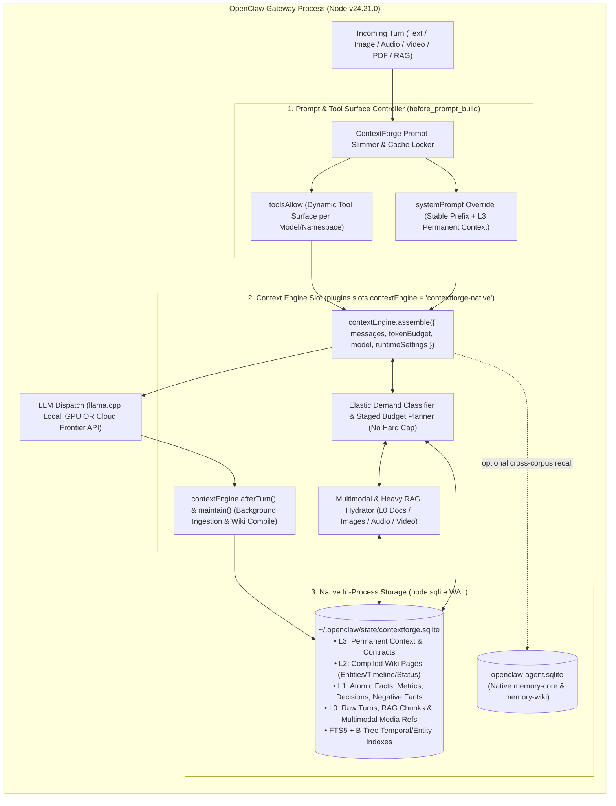

# ContextForge v2 Native Engine (`contextforge-native`)
## 01 — Architecture Decision Review, OpenClaw Interception Contract & System Overview

**Authors**: ContextForge contributors
**Date**: October 25, 2026
**Status**: Complete Design & Specification Kit (Awaiting the owner's Review)
**Target Location**: `<workspace>/extensions/contextforge-native`
**Native Database**: `~/.openclaw/state/contextforge.sqlite` (via built-in Node v24 `node:sqlite`)

---

## 1. Executive Summary & Core Thesis

OpenClaw's default runtime (`plugins.slots.contextEngine = "legacy"`) operates as an append-only transcript stack:
1. Every turn starts with a **~14,000–22,000 token global system prompt** (`AGENTS.md`, `SOUL.md`, `USER.md`, `MEMORY.md`, skills catalog, and 15+ JSON tool schemas).
2. Every user message, tool call, tool result, and assistant response is appended to the active session transcript until the window approaches `contextTokens` (32k–64k on local models, 922k on cloud), at which point a **blocking compaction pass** summarizes the transcript down to ~18k–24k tokens and starts growing all over again.

That legacy design breaks down in two ways:
- **On Small-Window Models (e.g., 16k–64k `contextTokens`):** Pushing 22k system tokens + 20k–40k transcript tokens consumes almost the entire window before reasoning even begins, triggers frequent compactions, and dilutes attention ("lost in the middle").
- **On Large-Window Models (e.g., 128k–1M+ `contextTokens`):** Unstructured 400k-token chat transcripts bury critical decisions, negative findings, and constraints inside stale chatter, while compaction summaries inevitably lose exact numbers or provenance.

**ContextForge v2 (`contextforge-native`)** replaces this entire stack with a **100% plug-and-play, model-agnostic, in-process TypeScript engine backed by Node v24's built-in `node:sqlite`**:
1. **Zero Hardcoded Cloud/Local or Project Assumptions — Pure Dynamic Envelope Discovery:**
   - ContextForge never branches on "cloud vs. local" or hardcoded model names, and contains zero project-specific or user-specific rules in its code.
   - On every turn, it inspects the **active model's live `CapabilityEnvelope`** directly from OpenClaw's runtime (`contextWindow`, `contextTokens`, `tokenBudget`, `maxTokens` output reserve, and `input` modalities `["text", "image", "audio", "video"]`, plus live slot `n_ctx` when an OpenAI-compatible `/slots` or `/v1/models` endpoint is present) and computes the exact usable token ceiling $H$ dynamically.
2. **Direct Control of Both the System Prompt and Message Array:**
   - Package `contextforge-native` registers engine ID **`"contextforge"`** and claims **`plugins.slots.contextEngine = "contextforge"`** (`ownsCompaction: true`, `currentTurnFence: "before-current-turn-entry-v1"`, `turnAdvancementIdempotency: "atomic-idempotent-v1"`) to take full ownership of `ingest()`, `assemble()`, `commitTurn()`, and `maintain()`.
   - Uses **`before_prompt_build`** (returning `systemPrompt` and optional `toolsAllow`) to scale fixed prompt overhead proportionally to the discovered `CapabilityEnvelope`—automatically keeping the fixed prefix compact when $W$ is tight (e.g., $\le 65,536$ tokens) or when a namespace configures a dedicated domain contract, while preserving full capability discovery.
   - Keeps **`plugins.slots.memory = "memory-core"`** untouched so OpenClaw's native vector `memory_search`, `memory_get`, and `memory-wiki` continue to work as an additional layer.
3. **Never Compact Again (`ownsCompaction: true`):**
   - Every turn and document is ingested into `contextforge.sqlite` (`L0` raw store) and deterministically compiled at ingestion time into `L1` structured facts/metrics and `L2` source-backed Wiki pages (`entities`, `concepts`, `timeline`, `status`, `decisions`, `negative-facts`, `constraints`).
   - Because `assemble()` dynamically constructs the exact working context for each turn from `[L3 Permanent Context + Staged L2/L1 Recall + Supporting L0 Evidence + Bounded Verbatim Tail]`, the active prompt never accumulates unbounded dead weight. `compact()` becomes a zero-latency no-op (`{ ok: true, compacted: false }`).
4. **Elastic, Demand-Driven Context Scaling (Zero Artificial Hard Cap: 1.5k up to $H$ / 100k–1M+ Tokens):**
   - ContextForge v2 **never imposes a static ceiling** on context length.
   - Every turn starts at the minimum token spend needed to satisfy query obligations (~1.5k–3.5k tokens on routine conversational turns) and expands through staged demand tranches (`25% -> 50% -> 75% -> 100%`, then doubling $Q \rightarrow 2Q \rightarrow \dots$ up to the model's full usable capacity $H$) whenever the turn demands heavy RAG, multi-document synthesis, or **multimodal inspection (images, audio, video, documents)**.

---

## 2. Decision Chronology & Recovered Architectural Lineage

Per the Architecture Decision Review protocol, we audited prior ContextForge and predecessor context-engine records to ensure every proven invariant is preserved and every superseded bottleneck is retired:

| Date | Source / Repository | Decision / Finding | Status in ContextForge v2 |
| :--- | :--- | :--- | :--- |
| **2026-04-08** | Early memory requirements review | User requested a ContextForge-style solution to maintain coherent context over long sessions without losing facts. | **Core Requirement** — realized via `contextEngine.assemble()`. |
| **2026-05-01 & 2026-06-20** | `Betanu701/ContextForge` (`docs/wiki_memory.md`, `docs/methodology.md`) | **Raw sources (`L0`) remain authoritative.** Compiled wiki pages (`L2`) are derived routing/compression indexes that must carry explicit `Source: <id>` citations so the loader can pull raw evidence when needed. | **Preserved & Enforced** — `sources` / `artifacts` (`L0`) vs `facts` (`L1`) and `derived_nodes` (`L2`) with foreign-key `provenance` links. |
| **2026-06-20** | `Betanu701/ContextForge` (`ProactiveLoader.load_wiki`) | **Staged Budget Expansion:** Spend budget in stages (25% -> 50% -> 75% -> 100%) only when evidence density/query complexity requires it, splitting budget between compiled wiki routing and raw source evidence. | **Extended** — generalized into the **Elastic Demand-Driven Planner** (scaling from 2k conversational turns up to 100k+ Heavy RAG / Multimodal). |
| **2026-08-25 & 2026-09-13** | Compaction architecture reviews | **Separate Active-Model Projection from Archive Storage:** Active model context should shrink/stay bounded as knowledge is factorized into structured state, while raw turns/spans remain in cold/archive SQLite storage without petabyte duplication. | **Preserved** — `sources`, `artifacts`, and `blobs` hold full raw turns/documents in SQLite/CAS; `assemble()` projects only the active semantic state + verbatim tail. |
| **2026-09-02** | `Betanu701/openclaw-contextforge` (`24ca1487651a`) | **Planner Ownership Reversal:** *"OpenClaw provides the envelope; ContextForge owns selection, promotion, compaction, and exclusion"* (`recallMaxTokens`, `allowedCategories`, `blockedCategories`, `minScore`, `maxSourceTokens`, planner receipts). | **Preserved & Upgraded** — ContextForge owns the entire `AssembleResult` and emits a structured `ContextForgePlanReceipt` every turn. |
| **2026-09-02** | `Betanu701/openclaw-contextforge` (Python HTTP sidecar + `kind: "memory"`) | Used an external Python HTTP sidecar (`localhost:8765`) and registered in `plugins.slots.memory`, which displaced `memory-core` and could only prepend text via `before_prompt_build` rather than replacing the transcript stack. | **Superseded** — Replaced by in-process TypeScript + `node:sqlite` registered in `plugins.slots.contextEngine`, keeping `memory-core` alive and eliminating the Python HTTP sidecar. |
| **2026-10-25** | Native engine requirements review | **New Requirements from the owner:** (1) Start fresh for the cleanest architecture; (2) Control the actual context layer + 22k system prompt so we never have to compact again; (3) Store natively in SQLite inside OpenClaw; (4) **No hard cap on context length**—scale to 100k+ for heavy RAG, documents, images, audio, and video. | **Canonical Spec v2** (this Spec Kit). |

---

## 3. OpenClaw Runtime Interception Architecture

### 3.1 Dual-Slot Coexistence (`contextEngine` + `memory`)

OpenClaw's plugin system has two exclusive slots:
- `plugins.slots.memory`: Remains set to **`"memory-core"`** (preserving OpenClaw's native embedding index, `memory_search`, `memory_get`, and `memory-wiki`).
- `plugins.slots.contextEngine`: Set to **`"contextforge"`** (registered by plugin package `contextforge-native`).



### 3.2 How ContextForge Controls Both the System Prompt and the Message Stack

#### A. Intercepting the 22k System Prompt (`before_prompt_build`)
In OpenClaw's embedded runner (`/app/dist/session-prompt-state-CmNvMcen.mjs` and `/app/docs/plugins/hooks/prompt-and-session.md`), a `before_prompt_build` handler can return:
```ts
return {
  systemPrompt: compiledSystemPrompt, // Completely replaces the 22k default bootstrap prompt when set!
  toolsAllow: resolvedToolAllowlist,  // Narrows submitted JSON tool schemas for local models!
};
```
ContextForge determines its prompt/tool budget purely from the **discovered `CapabilityEnvelope` ($W$ = effective context window, $H$ = usable history capacity after output/system/tool reserves)** and optional namespace policy—**never** by hardcoding "cloud" vs. "local" provider names:
1. **Envelope-Proportional Overhead Policy (Automatic Plug-and-Play Default):**
   - Before every turn, ContextForge measures the fixed prompt overhead $F = \text{systemTokens} + \text{toolSchemaTokens}$ against the model's effective context window $W = \min(\text{nativeContextTokens}, \text{deploymentContextTokens})$.
   - If $F$ exceeds the configured overhead budget ratio (default `maxFixedOverheadRatio = 0.15`, i.e., fixed system + tool schemas would eat $>15\%$ of the model's entire context window, such as a 22k prompt on a 32k/64k model), ContextForge automatically switches to **`"adaptive-slim"`**:
     - Compiles a **Dual-Channel System Prompt** (~800–1,500 tokens):
       - **Channel A (Persona & Voice):** Preserves `SOUL.md` / interpersonal persona in natural conversational prose (~250 tokens) so the model's warmth, candor, and humor never sound robotic.
       - **Channel B (Operational Rules & Domain Contracts — `<compiled_rules_ir>`):** Deterministically compiles operational rules (`AGENTS.md`, `USER.md`, and namespace `L3` contracts) into a compact **Symbolic / Code-Native DSL** (`@rule(...) => ...`), cutting rule tokens by 50%–70% while maintaining a feature flag (`symbolicIr: true | false`) so it can be toggled off instantly if ever needed.
     - Uses OpenClaw's native `tool_search` deferred-schema mechanism (or the active task capability profile) so only essential core tools are submitted inline while all other tools remain discoverable on demand.
   - If $F \le 0.15 \times W$ (for example, a 22k prompt on a 200k–1M window model where $F$ is only ~2% of $W$), ContextForge automatically uses **`"hybrid-stable"`**, keeping the full host `STABLE` prefix intact for prefix caching while still managing 100% of the conversation history and L1/L2/L0 recall via `assemble()`.
2. **Explicit Namespace Override (Optional):**
   - Any namespace or session can also explicitly pin `"slim-domain"`, `"hybrid-stable"`, or `"passthrough"` via `cf_permanent` if a user wants a dedicated domain persona regardless of model window size.

#### B. Intercepting the Conversation History (`contextEngine.assemble`)
When OpenClaw calls `contextEngine.assemble(params)`, ContextForge receives:
- `messages`: The full session transcript snapshot.
- `tokenBudget`: The model's available input token budget (e.g., `32,768` or `65,536` on local `llama.cpp`; `922,000+` on `cloud-model-C` / `cloud-model-B` / `cloud-model-A`).
- `model` & `runtimeSettings`: Exact provider, model ID, family, and limits.

Instead of returning all 2,500 historical messages, `assemble()` returns a **curated, prefix-cache-aligned `messages` array**:
1. **Epoch Summary / Working Context Anchor (Pinned at index 0 of `messages`):**
   - Contains the stable **L2 Compiled Wiki & L1 Fact Register** for the session/namespace as of the current `epoch`. Because this block only re-rolls when an Epoch boundary is crossed (e.g., every $N$ turns or on major topic shifts), **`llama.cpp` and cloud providers cache 100% of these tokens across consecutive turns!**
2. **Bounded Verbatim Tail (Last $K$ turns, e.g., 4–8 turns for local models, 12–20 turns for cloud):**
   - Preserves natural multi-turn conversational flow, exact recent phrasing, and active tool call/result chains.
3. **Just-In-Time (JIT) Elastic Evidence Injection (Inserted immediately before the latest user message):**
   - Contains turn-specific recalled **L2 wiki slices**, **L1 facts**, **L0 raw document chunks**, and **hydrated Multimodal content blocks (images, audio, video, PDF pages)** demanded by the current user query.
   - Because JIT evidence sits at the *tail* of the prompt right before the final user message, it **never invalidates the KV cache** of the System Prompt, the Epoch Anchor, or the Verbatim Tail!

#### C. Permanently Eliminating Blocking Compaction (`compact()`)
Because `info.ownsCompaction = true`:
- OpenClaw **never** runs its built-in summarization compaction.
- If OpenClaw's runner ever invokes `contextEngine.compact()` (e.g., if a single turn loaded 200k tokens of heavy RAG documents and crossed a threshold, or if the user types `/compact`), ContextForge executes an instantaneous (`< 10ms`) **SQLite Epoch Checkpoint**:
  - It commits any unindexed turns into `cf_turns_l0` / `cf_facts_l1` / `cf_wiki_l2`, increments the session's `epoch_id`, releases the one-off 200k RAG chunks from the active window, and returns `{ ok: true, compacted: true }`. Zero LLM calls, zero 7-minute spinners.

---

## 4. Complete Spec Kit Index

This Spec Kit is organized into four modular documents in `specs/`:

1. **`01-ARCHITECTURE-AND-INTERCEPTION-SPEC.md`** *(This document)*:
   - Executive summary, recovered decision chronology, OpenClaw `contextEngine` + `before_prompt_build` interception architecture, and system prompt modes.
2. **`02-SQLITE-STORAGE-AND-MULTIMODAL-SCHEMA.md`**:
   - Complete `node:sqlite` (`contextforge.sqlite`) DDL, L0–L3 hierarchy, deterministic ingestion-time Wiki compiler, provenance receipts, and first-class Multimodal (Image/Audio/Video/Document) storage & hydration.
3. **`03-ELASTIC-CONTEXT-PLANNER-AND-KV-CACHE.md`**:
   - Demand-driven Elastic Planner (scaling from 1.5k conversational turns to 100k–900k+ Heavy RAG/Multimodal with no hard cap), Staged Budget Expansion, KV-Cache Prefix Locking (`Epoch` architecture), and `ContextForgePlanReceipt` schemas.
4. **`04-TOOLS-MIGRATION-AND-IMPLEMENTATION-PLAN.md`**:
   - Agent tool contracts (`cf_recall`, `cf_remember`, `cf_permanent`, `cf_ingest`, `cf_wiki_lint`, `cf_status`), Health Journal & global workspace migration plan, verification benchmark suite, and parallel build milestones for implementation team + `cloud-model-B`.
